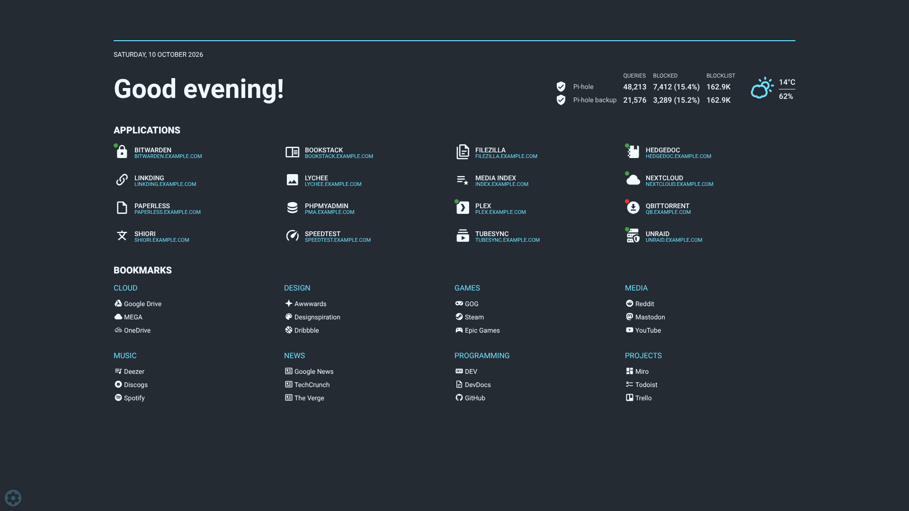
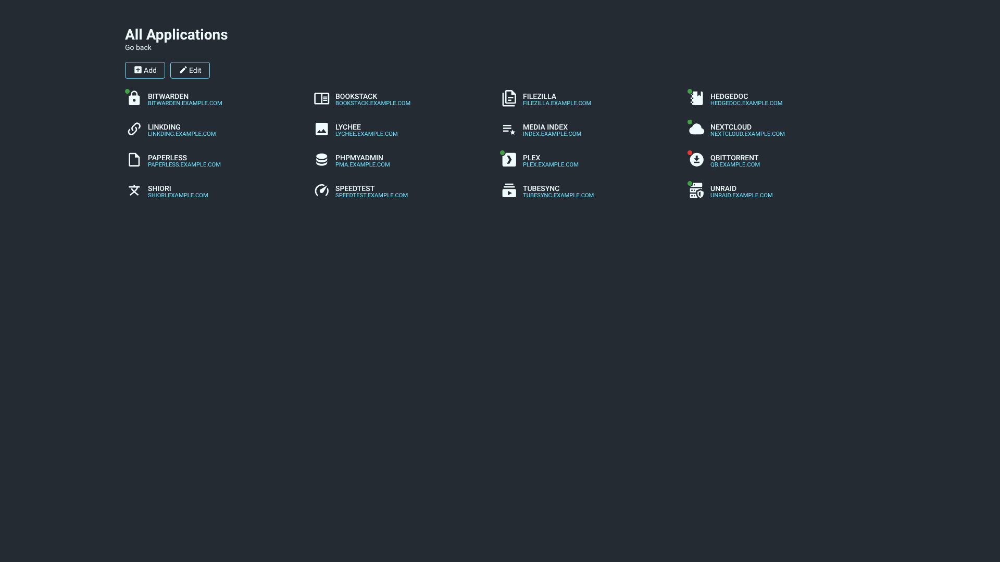
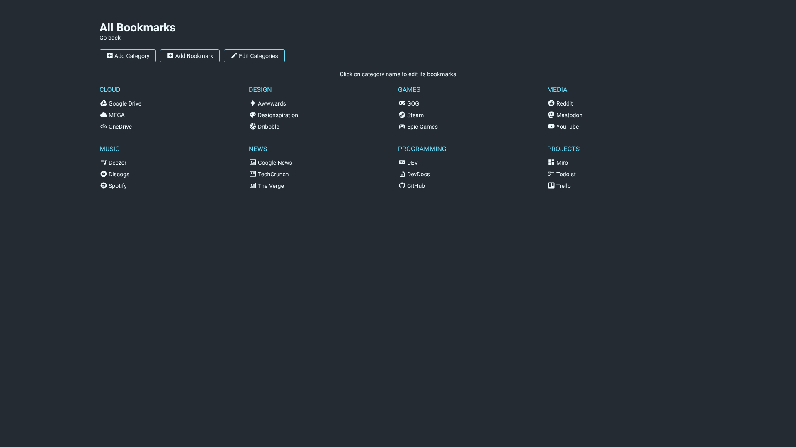
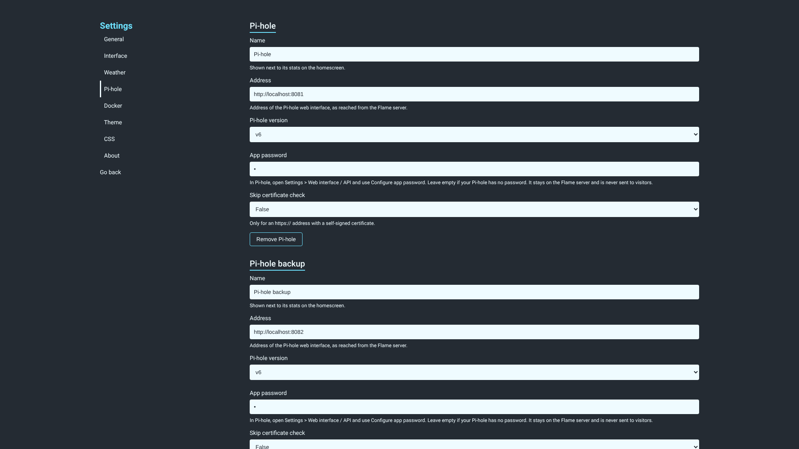
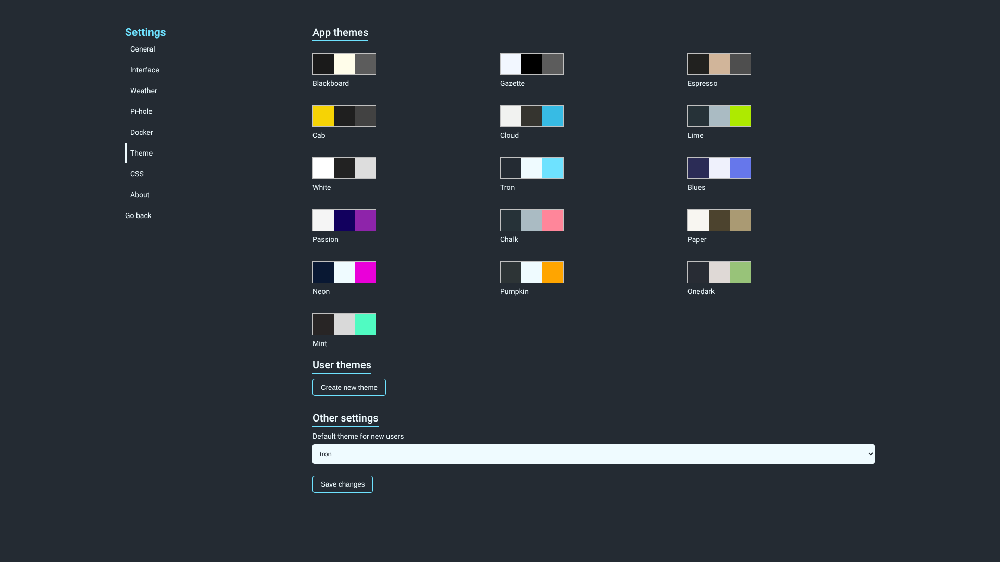

# Flame Revamped



Flame is a self-hosted start page for your server. You build your own hub of applications and bookmarks with built-in editors, so there are no config files to write by hand.

Flame Revamped is a maintained fork of [Flame by Paweł Malak](https://github.com/pawelmalak/flame). The original project is no longer updated, so this fork keeps it alive with security fixes, current dependencies and new features. Thanks to Paweł and the original contributors for the app this is built on.

## What's new in this fork

- **Pi-hole widget** for one or more Pi-holes (v5 and v6), with click-to-pause for logged-in admins.
- **Security hardening:** a Content-Security-Policy, sanitized SVG icons, blocked `javascript:` and similar URLs, login tokens tied to the admin password, a random signing key per install, and a non-root container. Details are in [docs/SECURITY_PERFORMANCE_REVIEW.md](docs/SECURITY_PERFORMANCE_REVIEW.md).
- **Faster homescreen:** about 114 KB of JavaScript instead of 759 KB, because the full icon set is no longer loaded up front.
- **Smaller, cleaner image:** Node 24 on Alpine, with 0 known CVEs in the 1.8.2 scan ([docs/IMAGE_CVE_REVIEW.md](docs/IMAGE_CVE_REVIEW.md)). Published for amd64 and arm64.
- **Drag-and-drop** reordering of apps and bookmarks on the homescreen when logged in (press and hold on touch screens).
- **Up/down status** dots for apps.
- **Backup & Restore** of apps, bookmarks, themes, settings and custom CSS from the settings page.
- **Layout settings** for dashboard width and the number of app and bookmark columns.
- **Kubernetes discovery works again** (it had been broken since `@kubernetes/client-node` 1.x).

The full list of changes is in [CHANGELOG.md](CHANGELOG.md).

## Features

- 📝 Create, edit and delete applications and bookmarks from the app with built-in editors
- 📌 Pin your favourite items to the homescreen
- 🔍 Search bar with local filtering, 11 web search providers and the option to add your own
- 🔑 Password login to protect your settings, apps and bookmarks
- 🎨 16 built-in color themes, a theme editor and custom CSS
- ☀️ Weather widget with temperature, cloud cover or humidity, and animated icons
- 🛡️ Pi-hole widget with today's queries, blocked queries, blocklist size and blocking status
- 🟢 Optional up/down health check per app
- 🐳 Docker and Kubernetes integration that adds apps from container labels or ingress annotations
- 💾 Backup & Restore

## Installation

### Docker (recommended)

Images are on Docker Hub as [`alexstapo/flame-revamped`](https://hub.docker.com/r/alexstapo/flame-revamped), for `linux/amd64` and `linux/arm64`.

| Tag | Meaning |
|-----|---------|
| `latest` | The newest release |
| `1.9` | The newest 1.9.x release |
| `1.9.0` | Exactly that release |

```sh
docker run -d \
  --name flame \
  -p 5005:5005 \
  -v /path/to/data:/app/data \
  -e PASSWORD='choose-a-strong-password' \
  --restart unless-stopped \
  alexstapo/flame-revamped:latest
```

Then open `http://<your-server>:5005`. To log in, open the settings (the cog in the bottom left), go to **App** and enter your password.

- `PASSWORD` is required. Flame refuses to start without it, and logs a warning if it is the old default `flame_password`.
- Keep `/app/data` on a persistent volume. It holds the database, settings, uploaded icons, backups and `secret.key`, the key that signs login tokens.
- The container runs as the non-root user `node` (uid 1000), so the data folder must be writable by uid 1000.
- The image has a built-in healthcheck on `/health`.

### Docker Compose

```yaml
services:
  flame:
    image: alexstapo/flame-revamped:latest
    container_name: flame
    restart: unless-stopped
    ports:
      - "5005:5005"
    volumes:
      - /path/to/data:/app/data
      # - /path/to/favicon.ico:/app/public/icons/favicon.ico  # optional: your own favicon
      # - /path/to/logs:/app/log  # optional: access.log for remote logging or fail2ban
      # - /var/run/docker.sock:/var/run/docker.sock  # optional: Docker integration (see "Docker socket security")
    environment:
      - PASSWORD=changeme
      # - TRUST_PROXY=1  # optional: when Flame is behind a reverse proxy
      # - CSP=off  # optional: turn off the Content-Security-Policy if a custom setup breaks
    healthcheck:
      test: ["CMD", "curl", "-fs", "http://localhost:5005/health"]
      interval: 60s
      timeout: 10s
      retries: 3
```

A commented example with Docker secrets is in [.docker/docker-compose.yml](.docker/docker-compose.yml).

### Kubernetes

Kustomize manifests are in [k8s/base](k8s/base): a namespace, deployment, service, ingress, and a read-only service account for ingress discovery. Treat them as a starting point. Before you apply them:

- set the deployment's `image` to `alexstapo/flame-revamped:<tag>`,
- give the container a `PASSWORD` environment variable, for example from a Secret,
- replace the `emptyDir` data volume with a PersistentVolumeClaim, or your data is lost when the pod is replaced.

### Without Docker

Flame needs Node.js 22.12 or newer (the image uses Node 24).

```sh
git clone https://github.com/AlexStapleton/Flame-Revamped
cd Flame-Revamped
npm run dev-init          # creates data/ and public/, installs server and client packages
npm run build --prefix client
cp -r client/dist/. public/
cp .env.example .env      # then set PASSWORD in .env
npm start
```

## Configuration

Settings are changed in the app. These environment variables control the server:

| Variable | Default | What it does |
|----------|---------|--------------|
| `PASSWORD` | none, required | The admin password. Changing it logs out every session. |
| `SECRET` | generated | Key that signs login tokens. Leave it unset (or `CHANGE_ME`) and Flame generates one and saves it in `data/secret.key`. |
| `PORT` | `5005` | Port the server listens on. |
| `TRUST_PROXY` | off | Number of reverse proxies in front of Flame, for example `1` behind a single nginx or Traefik. Needed so login rate limiting and the access log see real client IPs. Leave it unset if Flame is exposed directly. |
| `CSP` | on | Set to `off` to turn off the Content-Security-Policy. A warning is logged at startup. |
| `NODE_USE_ENV_PROXY` | unset | Set to `1` if Flame reaches the internet through `HTTP_PROXY` / `HTTPS_PROXY`. Without it the weather widget and the update check ignore the proxy. |
| `NODE_ENV` | `production` in the image | Use `development` only for local development, since it shows detailed errors. |

### Docker secrets

Flame reads every file in `/run/secrets` at startup. Each file sets the environment variable with the file's name in upper case, and overrides a value set the normal way. A secret named `password` therefore sets `PASSWORD`:

```yaml
services:
  flame:
    image: alexstapo/flame-revamped:latest
    secrets:
      - password

secrets:
  password:
    file: ./secrets/flame_password
```

### Content-Security-Policy

Flame sends a Content-Security-Policy that blocks injected scripts, frames and objects, while still allowing icons and custom CSS from anywhere. If a custom setup breaks under it, set `CSP=off` to turn it off.

### Upgrading

Pull the new image and recreate the container. Database changes run automatically on startup. A few releases need one extra step:

- **From before 1.8.0:** everyone has to log in once more, because login tokens are now tied to the password.
- **From before 1.8.1, if you use a proxy for outgoing traffic:** also set `NODE_USE_ENV_PROXY=1`.

Each release's notes are in [CHANGELOG.md](CHANGELOG.md).

## Usage

### Search bar

By default the search bar filters your apps and bookmarks. To search the web with a specific provider, start your query with its prefix. For example, `/g what is docker` searches Google. The 11 built-in providers are DuckDuckGo, Google, Disroot, Wikipedia, YouTube, Reddit, IMDb, The Movie Database, Spotify, Deezer and Tidal. Their prefixes, and the option to add your own, are under Settings > General.

More detail is in the original project's [search bar wiki page](https://github.com/pawelmalak/flame/wiki/Search-bar).

### Weather widget

1. Get an API key from [WeatherAPI.com](https://www.weatherapi.com/pricing.aspx). The free plan is plenty, since Flame makes fewer than 3,000 calls a month.
2. Get the latitude and longitude for your location, from [latlong.net](https://www.latlong.net/convert-address-to-lat-long.html) or with "Click to get current location" in the settings.
3. Enter both under Settings > Weather and save. The widget appears on the homescreen, and a new key works without a restart.

### Pi-hole widget

Works with Pi-hole v5 and v6, and with more than one Pi-hole (up to 10).

1. Get the secret Flame will use for each Pi-hole:
   - **v6:** in Pi-hole, open Settings > Web interface / API (Expert mode), use "Configure app password" and copy the app password. Skip this if your Pi-hole has no password.
   - **v5:** in Pi-hole, open Settings > API / Web interface and click "Show API token".
2. In Flame, open Settings > Pi-hole and click "Add Pi-hole". Enter a name, the address as Flame's server reaches it (for example `http://192.168.1.2`, or `http://pihole` inside a Docker network), the version, and the password or token. Repeat for each Pi-hole.
3. Save. Flame tests each Pi-hole and shows the result. The widget appears in the header on screens 900px and wider, with one row per Pi-hole.

When you're logged in, click a Pi-hole's shield to pause its blocking, and click the dimmed shield to turn blocking back on. How long a pause lasts is set under Settings > Pi-hole > Pause blocking: 30 seconds, 5 minutes (the default), 30 minutes, 1 hour, or until you click again. Visitors who aren't logged in can't toggle it.

Flame's server talks to the Pi-holes, so passwords and tokens never reach the browser. They are left out of backups, and visitors who aren't logged in see only each Pi-hole's name, not its address. A Pi-hole that can't be reached shows as "unreachable", and a logged-in admin sees the reason when they hover over it. For an `https://` address with a self-signed certificate, set "Skip certificate check" to True, or use the `http://` address instead. v5 sends its token in the URL, so prefer a LAN or Docker-network address for it.

### App status checks

Turn on "Health check" when adding or editing an app, and Flame shows a green or red dot for whether it is up. By default it checks the app's own URL every 60 seconds. You can give a separate "Status URL" instead.

### Backup & Restore

Under Settings > App, "Backup & Restore" exports your apps, bookmarks, categories, settings, themes, search providers and custom CSS to one file, and imports it again. Importing replaces what is there, and Flame saves a snapshot first. Secrets (the weather API key and Pi-hole passwords) are left out of the export, and the ones already set are kept on import.

### Docker integration

Turn on "Use Docker API" under Settings > Docker. Flame then adds an app for each container with these labels:

```yml
labels:
  - flame.type=application # "app" works too
  - flame.name=My container
  - flame.url=https://example.com
  - flame.icon=icon-name # optional, default is "docker"
# - flame.icon=custom # keeps an icon you uploaded in Flame
```

Several apps can come from one container. Separate the values with `;`:

```yml
labels:
  - flame.type=application
  - flame.name=First App;Second App
  - flame.url=https://example1.com;https://example2.com
  - flame.icon=icon-name1;icon-name2
```

If a container has no `flame.url` label, Flame uses the host from its Traefik router rule.

"Unpin stopped containers / other apps" under Settings > Docker unpins discovered apps whose container stops or disappears. It only touches apps Flame discovered itself, so apps you added by hand stay pinned.

#### Docker socket security

Mounting `/var/run/docker.sock` into a container is root-equivalent on the host, since anyone who can reach the socket can start privileged containers. Prefer a read-only socket proxy that only exposes the endpoints Flame needs:

```yml
services:
  docker-socket-proxy:
    image: tecnativa/docker-socket-proxy:latest
    environment:
      - CONTAINERS=1
    volumes:
      - /var/run/docker.sock:/var/run/docker.sock:ro
```

Then set Flame's **Docker host** (Settings > Docker) to `docker-socket-proxy:2375`.

- If you mount the socket directly instead, Flame needs the socket's group to read it, since it runs as `node`: add `group_add: ["<docker gid>"]` (find the gid with `getent group docker`).
- The default Docker host, `localhost`, means the local socket. A remote daemon is given as `host:port`, or with a scheme such as `https://host:2376`. Client-certificate TLS is not supported, so put a TLS-terminating proxy in front of the daemon.

<details>
<summary>Exposing a remote Docker daemon over TCP</summary>

On the Docker host, open `/lib/systemd/system/docker.service`, find `ExecStart` and change it to:

```text
ExecStart=/usr/bin/dockerd -H tcp://0.0.0.0:${PORT} -H unix:///var/run/docker.sock
```

This keeps the Unix socket and adds a TCP port that accepts connections from any address. Only do this on a trusted network, or use the socket proxy above. Then restart Docker and test it:

```shell
sudo systemctl daemon-reload
sudo service docker restart
curl http://${IP}:${PORT}/version
```

</details>

### Kubernetes integration

Turn on "Use Kubernetes Ingress API" under Settings > Docker. Flame must run inside the cluster, with a service account that can list ingresses (the one in [k8s/base/rbac.yaml](k8s/base/rbac.yaml) can). Flame then adds an app for each ingress with these annotations:

```yml
metadata:
  annotations:
    flame.pawelmalak/type: application # "app" works too
    flame.pawelmalak/name: My container
    flame.pawelmalak/url: https://example.com
    flame.pawelmalak/icon: icon-name # optional, default is "kubernetes"
```

### Custom CSS and themes

Custom CSS goes under Settings > CSS, and your own themes are made under Settings > Theme. The original project's wiki has guides for [custom CSS](https://github.com/pawelmalak/flame/wiki/Custom-CSS) and [a custom theme with CSS](https://github.com/pawelmalak/flame/wiki/Custom-theme-with-CSS).

### Import HTML bookmarks (experimental)

A script in `.dev` imports a browser's HTML bookmarks export. It has only been tried with Firefox exports, and the icons it makes are sometimes wrong. Back up `data/db.sqlite` before running it.

```sh
pip3 install Pillow beautifulsoup4
python3 .dev/bookmarks_importer.py --bookmarks <path to bookmarks.html> --data <path to flame data folder>
```

## Screenshots









## Development

### Technology

- Backend: Node.js, Express 5, Sequelize with SQLite
- Frontend: React 19, Redux, TypeScript, built with Vite
- Deployment: Docker (Node 24 on Alpine) and Kubernetes

### Dev environment

You need Node.js 22.12 or newer.

```sh
git clone https://github.com/AlexStapleton/Flame-Revamped
cd Flame-Revamped

cp .env.example .env    # then set PASSWORD and NODE_ENV=development
npm run dev-init        # run once

npm run dev             # starts the server on :5005 and Vite on :5173
```

Open `http://localhost:5173`. Vite sends `/api` calls to the server on port 5005.

Checks that CI runs:

```sh
npm test                        # server tests
npm run build --prefix client
npm run typecheck --prefix client
```

### Building the image

```sh
docker buildx build \
  --platform linux/amd64,linux/arm64 \
  -f .docker/Dockerfile.multiarch \
  -t flame-revamped:local \
  .
```

Releases are published to Docker Hub by a GitHub Actions workflow when a `v*` tag is pushed. See [docs/DOCKER_PUBLISH.md](docs/DOCKER_PUBLISH.md).

## More documentation

- [CHANGELOG.md](CHANGELOG.md): what changed in each release
- [docs/SECURITY_PERFORMANCE_REVIEW.md](docs/SECURITY_PERFORMANCE_REVIEW.md): the security and performance review behind 1.8.0
- [docs/DEPENDENCY_MODERNIZATION.md](docs/DEPENDENCY_MODERNIZATION.md): the dependency upgrades in 1.8.1
- [docs/IMAGE_CVE_REVIEW.md](docs/IMAGE_CVE_REVIEW.md): why the image moved to Alpine
- [docs/DOCKER_PUBLISH.md](docs/DOCKER_PUBLISH.md): how images are built and published

## Credits and license

Flame was created by [Paweł Malak](https://github.com/pawelmalak/flame). Flame Revamped is maintained by [Alex Stapleton](https://github.com/AlexStapleton). Both are released under the [MIT License](LICENSE.md).
